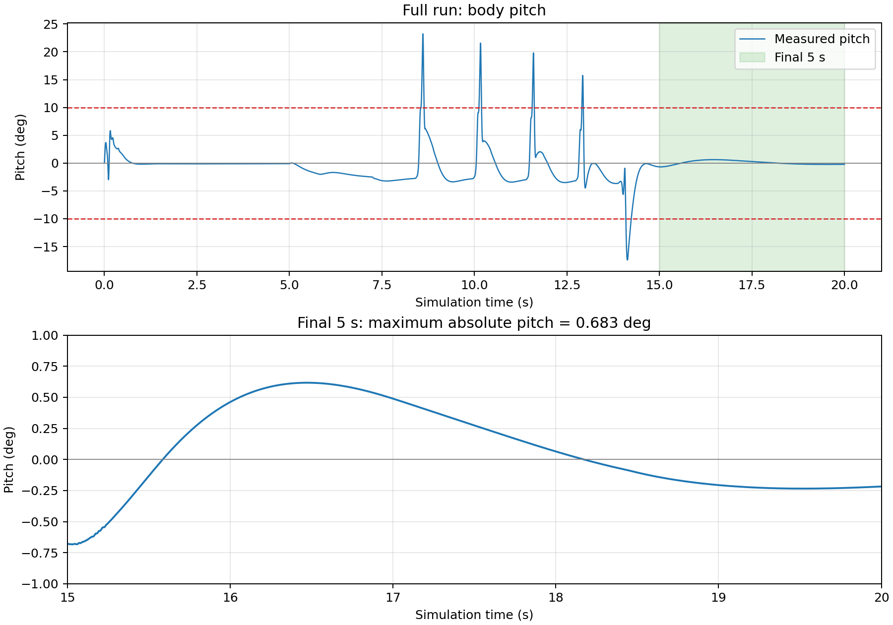
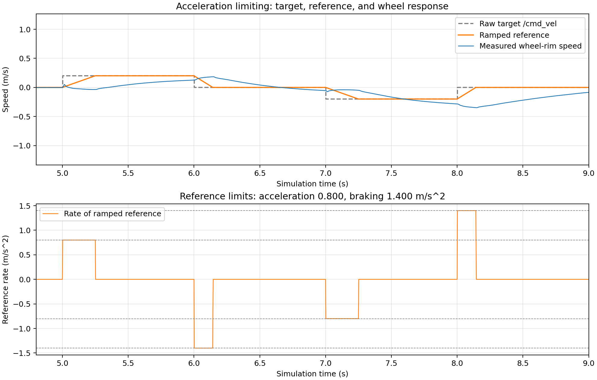
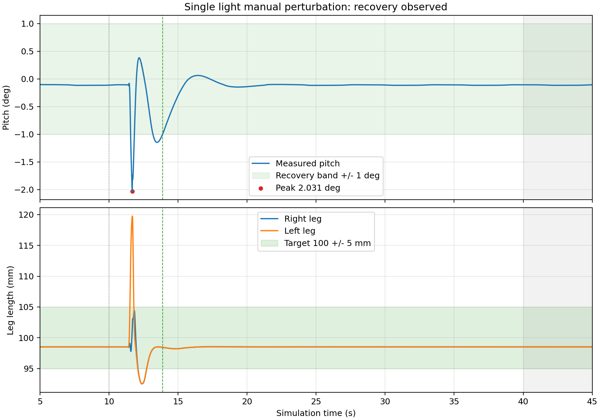

# wheel_leg_controller：ROS2 轮足 VMC 与 LQR 控制器

## 控制结构

这是一个独立的 `ament_python` 控制包，运行节点 `wheel_leg_controller`。控制器通过 ROS2 话题闭环工作，不导入或调用 MuJoCo；仿真器及障碍模型未修改。

```text
/imu + /joint_states
        ↓ 按相同时间戳配对
IMU 俯仰角/角速度 + 关节位置/速度
        ↓
五连杆正运动学 → 腿长、腿角
        ↓
腿长 PD + 重力前馈 → 轴向力
LQR 六维状态反馈 → 轮力矩、髋关节力矩
        ↓ VMC 力矩映射、符号转换与限幅
/actuator_cmd（四路腿关节力矩、两路轮力矩）
        ↓
仿真器推进 0.002 s → 回传新状态
```

`/cmd_vel` 的 `linear.x` 设置目标轮缘速度，现有数值斜坡限制加减速；未实现 `angular.z` 转向跟随。站桩时冻结位置目标，运动时按参考程序更新位置目标。控制步由成对状态触发，墙钟定时器只负责日志。

## 源文件

- `wheel_leg_controller/wheel_leg_controller.py`：话题订阅、状态配对、执行器发布、CSV/JSON 记录和结束处理。
- `wheel_leg_controller/control_math.py`：腿长 PD、LQR 和 VMC 的组合。
- `wheel_leg_controller/vmc_cal.py`：教程的五连杆运动学与 VMC 模块，保持原样。
- `wheel_leg_controller/lqr_update.py`：教程的 LQR 状态更新和随腿长变化的 K 多项式；下述一组数值系数已调整。
- `evaluation/obstacle_demo_20261021_213229/`：本次实际运行的 CSV、JSON 和生成的 pitch 曲线。

## K 与参数来源

算法来源为仓库 `Wheel_Leg/LQR_VMC/` 的参考实现。控制器未导入原单进程主循环，未复制其仿真主循环。保留原 VMC 历史变量的更新行为，没有改变其微分计算方式。

K 由参考模块的 12 组三次多项式按当前腿长计算。本次调参将 `POLY_COEFFICIENT[10]`，即轮力矩对机体俯仰角速度的反馈系数多项式，整体乘以 2：

```text
原值 [ 6.319481, -2.298235, -1.392479, 0.830905]
现值 [12.638962, -4.596470, -2.784958, 1.661810]
```

该调整是在原参考系数基础上的仿真经验调参，没有重新求解 Riccati 方程，不能称为重新完成 LQR 最优设计。其余 K 多项式系数保持参考值。

| 参数 | 当前数值 | 来源或用途 |
|---|---:|---|
| 控制步长 | 0.002 s | 模型与参考离散控制器 |
| 轮半径 | 0.060 m | 原模型 |
| 目标腿长 | 0.100 m | 参考初始目标 |
| 腿长 Kp / Ki / Kd | 700 / 0 / 5 | 参考配置；D 项使用相邻步误差差值，不除以 dt |
| 腿长 PD 输出限幅 | ±150 | 参考配置 |
| 轴向力 | `4/cos(theta) + PD`，限幅 ±100 | 参考前馈与数值限幅 |
| 腿关节力矩限幅 | ±1.8 N·m | 原 VMC 模块 |
| 轮力矩限幅 | ±1.5 N·m | 参考配置 |
| 加速 / 减速斜坡 | 0.8 / 1.4 m/s² | 当前控制数学模块 |
| 本次前进目标 | 0.625 m/s | 越障参数试验；是目标值，不表示实际速度恒定 |

ROS 四元数计算得到的 pitch 与 Y 轴角速度按原控制程序取负；左右轮采用镜像符号，共模位置与速度采用 `(leftwheel - rightwheel)/2`。本次 JSON 记录了两个参考模块的 SHA256，便于确认参数版本。

## 本次实测与 pitch 曲线

环境：Ubuntu 24.04、ROS2 Jazzy、conda `rm_ros2`（Python 3.12）。本次记录由学习者于 2026-10-21 21:32 在带界面仿真中运行生成；CSV/JSON 由控制器自动保存，pitch 曲线随后由学习者执行画图脚本生成。

本次辅助演示使用 `realtime:=true rtf:=1.0 publish_clock:=true`，未加速播放。仿真时间 0–5 s 原地平衡；5 s 发目标速度 0.625 m/s，14.158 s 发零速度，20 s 结束。结束后的窗口静止不计为继续平衡时间。

| 指标 | 本次结果 | 判定口径 |
|---|---:|---|
| 控制步数 | 10000 | 每步 0.002 s |
| 总仿真时间 | 20.000 s | 控制步数 × dt |
| 控制段实际耗时 | 19.999 s | 单调墙钟计时，不含启动等待 |
| 停车后的评估窗口 | 15–20 s | 连续 5 s 仿真时间 |
| 评估窗口实际耗时 | 5.0004 s | CSV 对应墙钟窗口 |
| 窗口内 pitch 最大绝对偏差 | 0.683° | 小于 10° |
| 右腿长最大绝对误差 | 4.702 mm | 不超过 5 mm |
| 左腿长最大绝对误差 | 4.694 mm | 不超过 5 mm |

上述误差为整个评估窗口内的最大绝对值，不以平均值或单个最终样本替代。最大偏差小于 10° 的结论仅适用于停车后的评估窗口；越障过程中允许出现更大的俯仰变化。



上图横轴是仿真时间（秒），纵轴为 pitch（度）；0° 表示机体直立。上半图显示全过程，红色虚线为 ±10°，绿色区域为最后 5 秒；下半图放大该窗口。[原速录屏（19.9秒）](evaluation/recordings/obstacle_demo_20261021_213229.webm)已随仓库提供；桌面原文件 `Screencast from 2026-10-21 21-32-32-00.00.00.000-00.00.19.871.webm`，容器时长实测 19.9 s。视频时长与数据中控制过程的仿真时长是不同计时口径。

数据文件：

- `evaluation/obstacle_demo_20261021_213229/balance_20261021_213232_403869.csv`
- `evaluation/obstacle_demo_20261021_213229/balance_20261021_213232_403869.json`

本次已完成平衡闭环与上述联合腿长检查，并演示前进越障。CSV 的轮里程计不能直接视为真实机体位移；本次 0.625 m/s 目标的越障演示也不能替代教程加分项“0.3 m/s 前进 3 m”的专项验收。新增的单次轻推恢复见后文；手柄和转向跟随未验收。JSON 中 `motion_bonus_validated=false` 与此一致。

## 构建与基础运行

```bash
source ~/miniforge3/etc/profile.d/conda.sh
conda activate rm_ros2
export PYTHONNOUSERSITE=1
source /opt/ros/jazzy/setup.bash
cd ~/venom_cpp_basics/training/02-ros2-wheelleg/Tutorial/ros2_ws
colcon build --symlink-install --packages-up-to wheel_leg_controller
source install/setup.bash
```

两个终端分别加载相同环境。先停止旧仿真、旧控制器和 `wheel_leg_bridge`，从新初始场景运行：

```bash
# 终端 A：启动仿真器
ros2 run wheel_leg_sim wheel_leg_sim --ros-args -p realtime:=true -p rtf:=1.0 -p publish_clock:=true
```

```bash
# 终端 B：基础站桩测试，默认 5000 步，目标速度为 0
ros2 run wheel_leg_controller wheel_leg_controller
```

控制器默认在 10 秒仿真时间后输出一次零力矩并结束控制；这不是持续无限运行。`target_length` 在节点启动时读取，运行中不要仅靠 `ros2 param set` 判断其已经改变控制目标。

本机越障演示可运行工作区辅助脚本 `bash run_obstacle_demo.sh`；调度脚本位于 `obstacle_demo/`，仅发布速度目标并启动节点。它使用隔离域 188，所有手动发布命令的终端也须使用同一域，且不能再同时启动第二组相同节点。辅助脚本在本工作区内，独立提交包时应另附这些复现脚本。

本机画图命令：`/usr/bin/python3 obstacle_demo/plot_pitch.py`，使用系统 matplotlib，画图依赖不参与控制闭环。

## 阶段记录与材料说明

前期轮速 PI 试验在目标 0.5 m/s 下，日志记录末段平均相对误差右 11.9%、左 11.5%；它不表示所有瞬时误差都小于 20%。腿长最终以 VMC 与 LQR 联合闭环检查为准。

本次提交应包含本包源码、此 README、所引用的曲线与数据，以及学习者自行录制的 19.9 秒视频。根据教程，“10–20 秒录屏”和含 `/imu /joint_states /actuator_cmd` 的 bag 为二选一；选择录像时不必为此补录 bag。早期助手后台测试的 bag 和旧版本数据不是此次个人录像，不能混用其旧指标说明当前参数版本。

按教程 02 第 8.3 节，向课程提交自己的 Fork 仓库链接；材料入口见本仓库的 `02-ros2-wheelleg/作业提交说明.md`。


## 加分验证：速度斜坡和单次轻推恢复

### 加速度限制（目标速度斜坡）

记录：`evaluation/acceleration_demo_20261021_224232/`。学习者运行原速前进/停车/后退/停车测试，再执行画图脚本分析。

CSV 实测内部目标最大加速斜率为 0.800 m/s²、减速斜率为 1.400 m/s²，符合设定。5–9 s 的实测轮缘速度差分加速度峰值约 6.416 m/s²。该实现限制内部速度参考的变化率，并不对实际轮子或机体施加相同数值的硬加速度限幅；不能写成“实际加速度始终不超过 0.8/1.4”。这轮最后 5 s 的 pitch 最大偏差 0.225°、左右腿长最大误差约 1.498 mm。



### 单次轻微人工扰动恢复

记录：`evaluation/disturbance_single_20261022_000746/`，2026-10-22 00:07 由学习者在 MuJoCo 界面进行一次轻微拖动施力，随后松手。目标速度保持 0，仿真倍率 1.0，共运行 45 s。

- 受扰前 5–10 s，pitch 最大偏差约 0.116°。
- 在 10–20 s 响应区间，pitch 最大绝对偏差 2.031°，峰值发生于仿真 11.684 s。
- 约在仿真 13.884 s 后，pitch 持续保持在 ±1°，且双腿长度误差均保持在 ±5 mm，直到记录结束。
- 从俯仰峰值到上述持续恢复区间相隔 2.200 s。这是根据响应曲线计算的时间，**不是从松手时刻起算的恢复时间**；实际施力开始/结束时刻没有同步记录。
- 最后 40–45 s：pitch 最大偏差 0.1155°，右/左腿长最大误差 1.4774/1.4761 mm；原平衡与腿长检查通过。



曲线中的 10 s 竖线表示操作提示时刻，不是测得的施力开始时刻。绿色竖线表示上述持续恢复区间的起点，灰色区域是最后 5 s 检查窗口。

这是一次特定轻微人工扰动下的恢复演示。推力大小、方向与施力持续时间未定量测量，因此不能给出牛顿数、冲量上限或通用抗扰保证。此前较大或重复扰动的记录未通过，不计入成功结果，原记录保留在本地。手柄任务按学习计划跳过；0.3 m/s 前进 3 m 的专项验收仍未完成。

画图与分析使用已有实验数据，没有重新生成或替换原始 CSV/JSON。部分实验结束时遇到 GLFW 图形窗口退出断言；完整数据已经保存，退出问题尚未修复，未修改冻结仿真器来规避。
